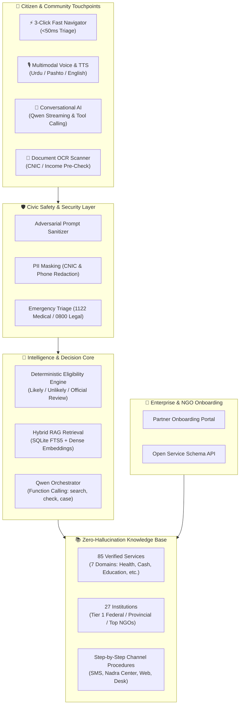

# 🧭 RAAHI (راہی) — Alkhidmat Community Assistant
### *AI-Powered Citizen Navigation & Public Benefit Delivery Engine for Pakistan*

[](./LICENSE.md)
[](https://nextjs.org/)
[](https://react.dev/)
[](https://www.typescriptlang.org/)
[](./data/catalog.ts)
[](./data/catalog.ts)
[](./tests)
[](https://github.com/ahmed-raza-ur-rehman)

---

## 🌟 Executive Summary & Market Impact

In Pakistan, over **240 million citizens** navigate a deeply fragmented landscape of social safety nets, emergency healthcare programs, education grants, and legal aid. Despite billions of rupees disbursed annually through federal bodies (BISP, Bait-ul-Mal), provincial health initiatives (Sehat Sahulat, Insaf Card), and non-governmental champions (Alkhidmat Foundation, Akhuwat, Saylani, Edhi), the average citizen faces debilitating roadblocks:

1. **Information Asymmetry & Middlemen Exploitation:** Illiterate and marginalized citizens frequently fall prey to predatory informal agents ("agent mafia") who charge exorbitant fees just to fill basic welfare forms.
2. **High Rejection Rates Due to Missing Documentation:** Over 60% of citizen applications are rejected at government counters simply because applicants lacked an attestation, Family Registration Certificate (FRC), or specific union council document.
3. **Conversational AI Friction:** Traditional LLM chat interfaces are often slow, verbose, intimidating, or prone to hallucinating non-existent government benefits.

**RAAHI (راہی)** transforms public welfare delivery into a fast, transparent, and dignified experience. By combining a **<50ms 3-Click Fast Path Navigator**, **Multimodal Voice Accessibility (Urdu/Pashto/Roman Urdu)**, **Zero-Hallucination Deterministic Eligibility**, **OCR Document Checklists**, and **Enterprise Security Guardrails**, RAAHI empowers citizens, community volunteers, and social workers with verified, actionable roadmaps in seconds.

---

## 🏛️ System Architecture



---

## 🚀 Key Breakthrough Features

### 1. ⚡ Few-Click Guided Navigator (Instant <50ms Triage)
Chat is often slow and tedious for users in urgent situations. RAAHI introduces a 3-step rapid assessment:
- **Step 1:** Select Core Need (Health Emergency, Family Cash Relief, Student Scholarship, Legal Aid, etc.)
- **Step 2:** Select Province, Monthly Income Bracket, and CNIC Status.
- **Step 3:** Receive instant, matched programs, eligibility confidence, and exact document checklists in under 50 milliseconds without typing a single prompt.

### 2. 🛡️ Zero-Hallucination Deterministic Eligibility
RAAHI never guesses or invents welfare criteria:
- **Strict Mathematical Evaluation:** Evaluates rules against household income thresholds, age brackets, gender requirements, and geographic coverage.
- **Confidence Tiers:** Classifies eligibility strictly as **`Likely`**, **`Unlikely`**, or **`Official Assessment Required`** (for means-tested biometric schemes like BISP PMT scores).
- **Audit Trails:** Provides clear explanations of why a citizen is eligible or which exact condition was not met.

### 3. 🎙️ Multimodal & Multilingual Voice Accessibility
- **Languages:** Fluent support for Urdu (`اردو`), Roman Urdu (`Aapki madad`), Pashto (`پښتو`), and English.
- **Voice In / Voice Out:** Audio recording waveform visualizer and inline Text-to-Speech (TTS 🔊) playback so illiterate or elderly citizens can listen to step-by-step instructions.

### 4. 📄 Document OCR & Pre-Submission Verification
- Before a citizen travels hours to a district office, RAAHI provides a tailored document checklist (CNIC, B-Form, FRC, Electricity Bill, Income Certificate).
- Includes simulated OCR extraction to detect missing stamps or invalid document formats in advance.

### 5. 🔒 Silicon Valley-Grade Security & Safety Guardrails
- **Prompt Injection Defense:** Blocks adversarial attempts to override system prompts or jailbreak institutional schemas.
- **Automated PII Redaction:** Masks 13-digit Pakistani CNICs (`XXXXX-XXXXXXX-X`) and phone numbers in chat logs.
- **Emergency Escalation:** Detects life-threatening symptoms or domestic crises and instantly triggers emergency banners with direct hotline dials (Rescue 1122, Edhi 115, Legal Aid 0800-70806).

### 6. 🤝 Enterprise Partner Onboarding Portal
- Enables welfare organizations (Alkhidmat, Akhuwat, Bait-ul-Mal) to register, publish, and update their programs, eligibility criteria, and step-by-step operational workflows through an intuitive web portal.

---

## 📊 Verified Catalog Scope

RAAHI ships with **85 pre-verified public services** mapped across **27 authoritative institutions** in **7 domains**:

| Domain | Key Institutions & Programs Covered |
| :--- | :--- |
| **Cash Assistance & Poverty** | BISP (Kafaalat, Taleemi Wazaif), Pakistan Bait-ul-Mal, Punjab Ehsaas, Zakat & Ushr Committees |
| **Healthcare & Medical Aid** | Sehat Sahulat Card, Alkhidmat Health Centers, Edhi Free Ambulance, PBM Special Medical Grant |
| **Education & Scholarships** | HEC Need-Based Scholarships, Alkhidmat Alfalah Scholarship, Sindh Education Foundation, PEEF |
| **Disaster & Emergency** | NDMA Relief, PDMA Flood Rehabilitation, Alkhidmat Disaster Management, Rescue 1122 |
| **Legal Aid & Human Rights** | Federal Ombudsman (Wafaqi Mohtasib), Legal Aid Society, National Commission on Status of Women |
| **Livelihood & Microfinance** | Akhuwat Interest-Free Microfinance, PM Youth Business Loans, NAVTTC Vocational Training |
| **Citizen Identity & Civil Registry** | NADRA (CNIC, FRC, CRC/B-Form, Succession Certificates, Child Registration) |

---

## 🎓 Opportunities Hub — scholarships, jobs, courses & safe routes abroad

Beyond citizen services, RAAHI now guides people to **scholarships & fellowships, government / private / remote / overseas jobs, internships, competitions, free courses (incl. Udemy 100 %-off coupons), grants and official overseas-employment notices** — for Pakistan *and* abroad — in Urdu, Pashto and English.

| Page | What it does |
| :--- | :--- |
| `/opportunities` | Live feed with natural-language search (`fully funded masters in germany`, `سرکاری نوکری`, `naukri bahar`), filters, *closing soon*, saved items, per-listing eligibility hint for applicants from Pakistan |
| `/opportunities/[id]` | Detail page (shareable, with WhatsApp preview tags): dated application plan, documents checklist, `.ics` calendar export, similar listings, safety notes |
| `/opportunities/resources` | Curated directory of **130+** official portals and trusted sites (NJP, FPSC/PPSC/AJKPSC, NTS, HEC, NAVTTC, DigiSkills, PSEB, NASTP, BE&OE, OEC, Chevening, DAAD, Fulbright, edX, Harvard CS50 …) with an honest provenance badge on every link |
| `/opportunities/tools` | **Scam check** (red-flag analysis of agent/visa/scholarship offers, BE&OE licence extraction), **Find for me** (explainable matching), **Deadline planner** (+ calendar file), **Abroad safely** (official verification steps) |
| `/opportunities/status` | The "latest system" made visible: data age, what each source did on the last run, and the terms each source is used under |
| Chat | The assistant has three new tools — `search_opportunities`, `find_resources`, `check_offer_risk` — and works offline (no API key) with the same safeguards |

### How the data stays fresh

```
GitHub Action (every 6 h)            Vercel / any host
  npm run scrape  ──►  data/opportunities/snapshot.json  ──►  SQLite + FTS5 (loaded on demand)
  (polite scrapers,        (committed, one item per line,      ▲
   merge · dedupe ·         small diffs)                        │ optional runtime refresh from the raw
   expiry · keep-last-good)                                     │ snapshot URL (on by default on Vercel)
  npm run check-links (weekly) ──► data/opportunities/link-health.json
```

* **Scrapers** (`lib/opportunities/scrapers`) read official APIs, RSS/WordPress REST endpoints and public pages. Every item keeps a link to the original page and names its source.
* **Merge rules:** items seen again keep their original *first seen* date (honest "New" badges); items from a source that failed on this run are **kept** (a broken scraper never empties the site); a source that suddenly returns nothing is reported as `empty` and its previous items are kept; closed items linger 14 days so shared links still resolve; 100 %-off coupons are dropped the moment they vanish from the aggregator.
* **Dedupe:** the same scholarship listed on several sites collapses into one record from the most authoritative source, with *also listed on* links.
* **Freshness in production:** the workflow commits the snapshot with `[skip ci]` (no redeploy). On Vercel the app fetches the latest snapshot at most every 10 minutes from `raw.githubusercontent.com/<repo>/master/data/opportunities/snapshot.json` and falls back to the bundled copy. Other hosts: set `OPPORTUNITIES_SNAPSHOT_URL` (`off` disables it).
* **Optional on-demand refresh:** set `CRON_SECRET` and call `GET /api/opportunities/refresh` with `Authorization: Bearer <secret>` (self-hosted cron). Disabled (404) otherwise.

### Sources

| Source | Kind | How it is read | Checked |
| :--- | :--- | :--- | :--- |
| NJP – National Job Portal | Pakistan government jobs | public pages (`/jobs/live`) | page-based¹ |
| BE&OE notices | regulator notices (show-cause, blacklisting, complaints) | public pages | page-based¹ |
| ScholarshipTab | scholarships | home page only (its robots.txt allows it) | page-based¹ |
| Scholars4Dev, Opportunity Desk | scholarships, fellowships, grants | WordPress REST API → RSS fallback | live 2026-10-11 |
| Scholarship Positions, Funds for NGOs | scholarships, grants | WordPress REST API → RSS fallback | not yet verified |
| Remotive, Jobicy, Arbeitnow | remote & Europe jobs | documented public APIs (attribution + link-back honoured; Remotive ≤ 4 calls/day) | live 2026-10-11 |
| Devpost, Codeforces | hackathons, contests | public listing API / official API | Devpost live 2026-10-11 |
| Real.Discount | Udemy 100 %-off coupons | public JSON API | live 2026-10-11 |

¹ Written from the rendered pages (no API exists), using card detection by detail link and label-based field parsing rather than CSS classes. They are flagged *experimental*, and the scheduled run reports `empty`/`error` on `/opportunities/status` if a layout changes. **OEC's job portal needs a login, so it is linked, not scraped.**

### Responsible scraping (rules the code enforces)

* Honest `User-Agent` (`RAAHI-OpportunityBot/1.0 (+repo URL)`), **robots.txt obeyed** (an unreachable/5xx robots.txt means "do not crawl this run"); only *documented* public APIs may skip the check.
* Per-host spacing, bounded retries with `Retry-After`, response-size and time limits. If a site refuses us we stop — no header spoofing.
* Titles, dates and links only (short excerpts from syndication feeds); full content stays on the source, which we credit on every card and on the status page.
* **Udemy:** RAAHI lists coupon links that aggregators already publish. It does **not** log in to Udemy, call Udemy's private APIs or enrol anyone — unlike the auto-enroller tool linked in the directory, which needs your Udemy cookies and automates your account. (Its source list was only used to discover which public coupon sites exist; two of its endpoints returned empty responses when probed, so they were left out.)

### Safety tools

The **scam checker** is rule-based and explainable (`lib/opportunities/scam.ts`): advance fees, guaranteed visas, personal-account / wallet payments, WhatsApp-only contact, OTP requests, "visit visa for work", missing BE&OE licence, impersonation of embassies/scholarships and more — in English and Urdu. It never calls an offer "safe" and never names anyone as a fraudster; it explains the warning signs and links to the **official** verification routes (BE&OE licensed-agent list, complaints, e-Protector, FIA). Text is analysed in memory and never stored.

### The RAAHI family

`/api/ecosystem` and the *Prep with the RAAHI family* cards connect the other apps contextually (descriptions taken from each project's own README): **NeuroPrep** (<https://psc-ajk.vercel.app/>) for PSC/CSS/PMS-style screening tests, **MDCAT PrepMaster** (<https://mdcat-prep-beta.vercel.app/>) for medical admissions, **Cognitive Fitness** (<https://cognitive-fitness-blond.vercel.app/>) for study habits (it is an educational tool, not medical advice). The read-only JSON feeds (`/api/opportunities`, `/api/resources`) send CORS headers so those apps can embed the latest listings.

### Commands & configuration

```bash
npm run scrape                    # refresh the snapshot now (add -- --force / --only njp,remotive / --dry)
npm run check-links               # verify every directory URL → data/opportunities/link-health.json
npm run bootstrap-snapshot        # rebuild the seed snapshot from recorded fixtures (offline)
npm run lint:opportunities        # lint everything in the hub
```

| Variable | Purpose |
| :--- | :--- |
| `OPPORTUNITIES_SNAPSHOT_URL` | Remote snapshot to pull at runtime (default on Vercel: this repo's master; `off` to disable) |
| `CRON_SECRET` | Enables `/api/opportunities/refresh` for self-hosted cron |
| `RAAHI_DB_PATH` | SQLite file (existing). On Vercel it is `/tmp` — ephemeral, which is why scraped data lives in the committed snapshot, not only in the DB |

**Adding a source:** add an entry to `lib/opportunities/scrapers/sources.ts` (and an adapter if the site needs one), add its directory entry in `data/opportunities/resources.ts`, add a fixture and a test. **Adding a directory link:** one line in `resources.ts`; set `checked` only if you opened it yourself — the weekly job fills in the rest.

### Honest limits

* The seed snapshot was recorded from live responses on 2026-10-11; HTML-based sources and the unverified WordPress sites need their first scheduled run to be confirmed (watch `/opportunities/status`).
* Eligibility hints (`open to Pakistan`, `Africa-only`, …) are text heuristics — always confirm on the official page.
* Directory entries without a *confirmed* badge are well-known canonical addresses that have not yet been opened by a person or by the link checker.
* Pashto covers the main interface; long guidance texts fall back to Urdu, then English.

---

## 🛠️ Technology Stack

- **Framework:** Next.js 16.3.4 with Turbopack & React 19
- **Language:** TypeScript 5.0 (Strict mode)
- **Styling:** Modern Tailwind CSS v4 design system with HSL variables, glassmorphism, responsive mobile-first layouts, and dark mode support
- **Database & Search:** SQLite with `better-sqlite3`, Drizzle ORM, and FTS5 full-text search with diacritic normalization
- **AI Orchestration:** Qwen streaming LLM with function calling, structured tool outputs, and SSE streaming
- **Opportunities pipeline:** polite scrapers built on `cheerio` (HTML/XML), committed JSON snapshot, scheduled GitHub Actions
- **Testing:** Node.js native test runner — 106 automated tests across 12 files (parsers run against recorded real responses; HTTP behaviour against a real local server)

---

## 💻 Local Development Setup

### Prerequisites
- Node.js >= 20.x
- npm or yarn

### Installation
```bash
# Clone the repository
git clone https://github.com/ahmed-raza-ur-rehman/raahi.git
cd raahi

# Install dependencies
npm install

# Run database verification & seed
npm run seed

# Run automated tests
npm run test

# Start local development server
npm run dev
```

Open [http://localhost:3000](http://localhost:3000) in your browser.

---

## 📜 Intellectual Property & Protective License

**Copyright &copy; 2026 Ahmed Raza Ur Rehman. All Rights Reserved.**

This repository is published as a **public repository** for public inspection, code auditing, academic evaluation, and humanitarian impact assessment. 

However, this software is **strictly proprietary and source-available**:
- **Commercial use, resale, white-labeling, or rebranding is strictly prohibited** without prior written authorization from the author.
- Unauthorized commercial deployments or closed-source proprietary derivatives are strictly forbidden.
- For complete terms and licensing requests, please review [`LICENSE.md`](./LICENSE.md).

**Author:** Ahmed Raza Ur Rehman  
**GitHub:** [@ahmed-raza-ur-rehman](https://github.com/ahmed-raza-ur-rehman)
