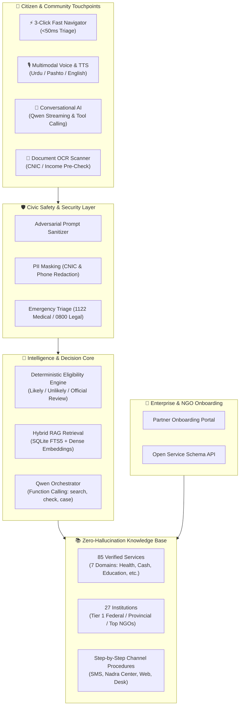

# 🧭 RAAHI (راہی) — Alkhidmat Community Assistant
### *AI-Powered Citizen Navigation & Public Benefit Delivery Engine for Pakistan*

[](./LICENSE.md)
[](https://nextjs.org/)
[](https://react.dev/)
[](https://www.typescriptlang.org/)
[](./data/catalog.ts)
[](./data/catalog.ts)
[](./tests)
[](https://github.com/ahmed-raza-ur-rehman)

---

## 🌟 Executive Summary & Market Impact

In Pakistan, over **240 million citizens** navigate a deeply fragmented landscape of social safety nets, emergency healthcare programs, education grants, and legal aid. Despite billions of rupees disbursed annually through federal bodies (BISP, Bait-ul-Mal), provincial health initiatives (Sehat Sahulat, Insaf Card), and non-governmental champions (Alkhidmat Foundation, Akhuwat, Saylani, Edhi), the average citizen faces debilitating roadblocks:

1. **Information Asymmetry & Middlemen Exploitation:** Illiterate and marginalized citizens frequently fall prey to predatory informal agents ("agent mafia") who charge exorbitant fees just to fill basic welfare forms.
2. **High Rejection Rates Due to Missing Documentation:** Over 60% of citizen applications are rejected at government counters simply because applicants lacked an attestation, Family Registration Certificate (FRC), or specific union council document.
3. **Conversational AI Friction:** Traditional LLM chat interfaces are often slow, verbose, intimidating, or prone to hallucinating non-existent government benefits.

**RAAHI (راہی)** transforms public welfare delivery into a fast, transparent, and dignified experience. By combining a **<50ms 3-Click Fast Path Navigator**, **Multimodal Voice Accessibility (Urdu/Pashto/Roman Urdu)**, **Zero-Hallucination Deterministic Eligibility**, **OCR Document Checklists**, and **Enterprise Security Guardrails**, RAAHI empowers citizens, community volunteers, and social workers with verified, actionable roadmaps in seconds.

---

## 🏛️ System Architecture



---

## 🚀 Key Breakthrough Features

### 1. ⚡ Few-Click Guided Navigator (Instant <50ms Triage)
Chat is often slow and tedious for users in urgent situations. RAAHI introduces a 3-step rapid assessment:
- **Step 1:** Select Core Need (Health Emergency, Family Cash Relief, Student Scholarship, Legal Aid, etc.)
- **Step 2:** Select Province, Monthly Income Bracket, and CNIC Status.
- **Step 3:** Receive instant, matched programs, eligibility confidence, and exact document checklists in under 50 milliseconds without typing a single prompt.

### 2. 🛡️ Zero-Hallucination Deterministic Eligibility
RAAHI never guesses or invents welfare criteria:
- **Strict Mathematical Evaluation:** Evaluates rules against household income thresholds, age brackets, gender requirements, and geographic coverage.
- **Confidence Tiers:** Classifies eligibility strictly as **`Likely`**, **`Unlikely`**, or **`Official Assessment Required`** (for means-tested biometric schemes like BISP PMT scores).
- **Audit Trails:** Provides clear explanations of why a citizen is eligible or which exact condition was not met.

### 3. 🎙️ Multimodal & Multilingual Voice Accessibility
- **Languages:** Fluent support for Urdu (`اردو`), Roman Urdu (`Aapki madad`), Pashto (`پښتو`), and English.
- **Voice In / Voice Out:** Audio recording waveform visualizer and inline Text-to-Speech (TTS 🔊) playback so illiterate or elderly citizens can listen to step-by-step instructions.

### 4. 📄 Document OCR & Pre-Submission Verification
- Before a citizen travels hours to a district office, RAAHI provides a tailored document checklist (CNIC, B-Form, FRC, Electricity Bill, Income Certificate).
- Includes simulated OCR extraction to detect missing stamps or invalid document formats in advance.

### 5. 🔒 Silicon Valley-Grade Security & Safety Guardrails
- **Prompt Injection Defense:** Blocks adversarial attempts to override system prompts or jailbreak institutional schemas.
- **Automated PII Redaction:** Masks 13-digit Pakistani CNICs (`XXXXX-XXXXXXX-X`) and phone numbers in chat logs.
- **Emergency Escalation:** Detects life-threatening symptoms or domestic crises and instantly triggers emergency banners with direct hotline dials (Rescue 1122, Edhi 115, Legal Aid 0800-70806).

### 6. 🤝 Enterprise Partner Onboarding Portal
- Enables welfare organizations (Alkhidmat, Akhuwat, Bait-ul-Mal) to register, publish, and update their programs, eligibility criteria, and step-by-step operational workflows through an intuitive web portal.

---

## 📊 Verified Catalog Scope

RAAHI ships with **85 pre-verified public services** mapped across **27 authoritative institutions** in **7 domains**:

| Domain | Key Institutions & Programs Covered |
| :--- | :--- |
| **Cash Assistance & Poverty** | BISP (Kafaalat, Taleemi Wazaif), Pakistan Bait-ul-Mal, Punjab Ehsaas, Zakat & Ushr Committees |
| **Healthcare & Medical Aid** | Sehat Sahulat Card, Alkhidmat Health Centers, Edhi Free Ambulance, PBM Special Medical Grant |
| **Education & Scholarships** | HEC Need-Based Scholarships, Alkhidmat Alfalah Scholarship, Sindh Education Foundation, PEEF |
| **Disaster & Emergency** | NDMA Relief, PDMA Flood Rehabilitation, Alkhidmat Disaster Management, Rescue 1122 |
| **Legal Aid & Human Rights** | Federal Ombudsman (Wafaqi Mohtasib), Legal Aid Society, National Commission on Status of Women |
| **Livelihood & Microfinance** | Akhuwat Interest-Free Microfinance, PM Youth Business Loans, NAVTTC Vocational Training |
| **Citizen Identity & Civil Registry** | NADRA (CNIC, FRC, CRC/B-Form, Succession Certificates, Child Registration) |

---

## 🎓 Opportunities Hub — scholarships, jobs, courses, guides & safe routes abroad

Beyond citizen services, RAAHI guides people to **scholarships & fellowships, government / private / remote / overseas jobs, internships, competitions, free courses (incl. Udemy 100 %-off coupons), grants and official overseas-employment notices** — for Pakistan *and* abroad — in Urdu, Pashto and English. It keeps itself current (scheduled scrapers), tells people **how to apply from Pakistan** (the step that is easy to miss), and says plainly **how sure it is of every date**.

| Page | What it does |
| :--- | :--- |
| `/opportunities` | Live feed (~1,000 listings) with natural-language search in English, Urdu and Roman Urdu (`fully funded masters in germany`, `سرکاری نوکری`, `naukri bahar`), **typo tolerance** (`scholrship germny` → *Showing results for scholarship germany*, said out loud on the page), filters, *closing soon*, saved items, **saved searches that count what is new since you last looked**, alerts & feeds, a per-listing eligibility hint for applicants from Pakistan, a share button |
| `/opportunities/calendar` | **Year planner** — 26 programmes that come round every year (Chevening, Commonwealth, Fulbright, DAAD, Stipendium Hungaricum, Türkiye Bursları, CSC, MEXT, GKS, Australia Awards, Gates Cambridge, Erasmus Mundus, Aga Khan, JJ/WBGSP, World Bank YPP, CSS/FPSC, KPPSC PMS, MDCAT, ECAT, HEC HAT, Google Summer of Code, Outreachy, NASA Space Apps, Hult Prize, Benazir/Ehsaas, public-university admissions): the usual months on a 12-month grid, what is open / closing / opening soon *today*, **who you apply through** (HEC, embassy, university, direct), what to prepare, and the latest dates marked **official** or **reported** with the day they were checked. Second tab: **live deadlines** — every dated listing closing in the next 60 days |
| `/opportunities/guides` | 13 bilingual step-by-step guides (after Matric/FSc, study-abroad roadmap, government jobs, CSS/PMS, MDCAT, English tests, CV/SOP, internships, freelancing, free learning, safe work abroad, spotting fake offers, document attestation) — each names the official page its facts come from and when it was last reviewed |
| `/opportunities/[id]` | Detail page (shareable, with WhatsApp preview tags): dated application plan, documents checklist, `.ics` export, similar listings, safety notes |
| `/opportunities/resources` | Curated directory of **192** official portals and trusted sites in 16 categories (NJP, FPSC/PPSC/AJKPSC, NTS, HEC, NAVTTC, DigiSkills, PSEB, BE&OE, OEC, Chevening, DAAD, Fulbright, edX …) with an honest provenance badge on every link; links the checker could not reach are labelled *unreachable from our servers*, never "broken" |
| `/opportunities/tools` | **Scam check** (red flags in agent/visa/scholarship offers, BE&OE licence extraction) · **Find for me** (explainable matching) · **Deadline planner** (+ calendar file) · **Age calculator** (upper age limits in government ads — reports both common readings of “not exceeding N years”) · **CV builder** (one page, parser-friendly, *Print → Save as PDF*; the draft lives only in the browser) · **Abroad safely** |
| `/opportunities/status` | The "latest system" made visible: data age, what each source did on the last run, and the terms each source is used under |
| Chat | Five assistant tools — `search_opportunities`, `find_resources`, `check_offer_risk`, `find_guides`, `find_programmes` — and the same answers offline (no API key), with the same safeguards. Naming a programme (`when does chevening open?`, `fulbright kab khulta hai`) returns its planner card; a scam warning or a planner answer stands alone instead of being diluted by loosely matched citizen-service cards |
| `<raahi-opportunities>` | A dependency-free, Shadow-DOM web component (`/embed/raahi-opportunities.js`, en/ur, light/dark, no cookies) that lets other sites show live listings — see *The RAAHI family* |

### How the data stays fresh

```
GitHub Action (every 6 h)              Vercel / any host
  npm run scrape  ──►  data/opportunities/snapshot.json  ──►  SQLite + FTS5 (loaded on demand)
  (polite scrapers,        (committed, one item per line,       ▲
   merge · dedupe ·         small diffs)                         │ optional runtime refresh from the raw
   expiry · keep-last-good)                                      │ snapshot URL (on by default on Vercel)
  Self-hosted runner in Pakistan (opt-in) ──► the same snapshot  (NJP, BE&OE)
  npm run check-links (weekly) ──► data/opportunities/link-health.json
  npm run digest (daily, opt-in) ──► Telegram channel
```

* **Scrapers** (`lib/opportunities/scrapers`) read official APIs, RSS/WordPress REST endpoints, the JSON that official sites' own pages load, and plain listing pages. Every item keeps a link to the original page and names its source. A WordPress source is asked for the full post first (the deadline and eligibility live there), then for excerpts, then for its RSS feed — a site that refuses one never takes the source down. The full text only fills gaps in inference (a plausible deadline, funding, eligibility) and is never stored.
* **Merge rules:** items seen again keep their *first seen* date (honest "New" badges); items from a source that failed on this run are **kept**; a source that suddenly returns nothing is reported as `empty` and its previous items are kept — except commissions that legitimately have nothing open (FPSC, PTS), which report *ok · no notice is open right now* unless the response changes shape; closed items linger 14 days so shared links still resolve; 100 %-off coupons are dropped the moment they vanish.
* **Dates read from free text must be plausible** (a job ad does not close 8 months out; a scholarship can be announced a year ahead) — otherwise no deadline is shown rather than a wrong one.
* **Dedupe:** the same scholarship listed on several sites collapses into one record from the most authoritative source, with *also listed on* links.
* **Freshness in production:** the workflow commits the snapshot with `[skip ci]` (no redeploy). On Vercel the app fetches the latest snapshot at most every 10 minutes from `raw.githubusercontent.com/<repo>/master/data/opportunities/snapshot.json` and falls back to the bundled copy. Other hosts: set `OPPORTUNITIES_SNAPSHOT_URL` (`off` disables it).
* **Optional on-demand refresh:** set `CRON_SECRET` and call `GET /api/opportunities/refresh` with `Authorization: Bearer <secret>`. Disabled (404) otherwise.

### Reach: feeds, calendar, digest, sitemap

* `GET /api/opportunities/feed?format=rss|atom|json&…` — subscribe to **any search** in a feed reader (same filters as the API; newest first; every entry links to its RAAHI page and the original).
* `GET /api/opportunities/calendar?…` — every matching deadline as an `.ics` calendar you can subscribe to (Google/Apple/Outlook); `GET /api/opportunities/[id]/calendar` for one listing (`?plan=1` adds the dated application plan).
* `GET /api/opportunities/digest?lang=en|ur&format=text|html|json&max=` — a short *what to look at today* message (closing within 7 days · new in Pakistan · new abroad · yearly programmes to act on), ready to paste into WhatsApp or post to Telegram. `npm run digest [-- --lang ur --telegram]` prints it; `.github/workflows/digest.yml` posts it daily **only if the owner switches it on** (create a bot with @BotFather, add secrets `TELEGRAM_BOT_TOKEN` and `TELEGRAM_CHAT_ID`, set the repository variable `DIGEST_ENABLED=true`). Nothing is ever posted otherwise.
* `GET /api/opportunities/flagships?q=&kind=&level=&funding=&route=&lang=` — the year planner as JSON (phase, days left, route, preparation, dates with their confidence).
* `/sitemap.xml` (pages, every guide, up to 500 listings; coupons excluded) and `/robots.txt` (API and private pages disallowed) — set `NEXT_PUBLIC_SITE_URL`, or rely on Vercel's production domain.

### Sources

32 registered sources (31 on). *Live-checked* means the real scraper ran on GitHub's own servers on **2026-10-15** and produced items (or, for FPSC and PTS, an honest "nothing open today").

| Group | Sources | How they are read | Status |
| :--- | :--- | :--- | :--- |
| Pakistan — official | FPSC (federal jobs, CSS), PTS (Pakistan Testing Service), SPSC, BPSC, ETEA (Khyber Pakhtunkhwa) | the public JSON FPSC's and PTS's own pages load; listing pages for the others | live-checked¹ |
| Pakistan — official, **needs a Pakistani connection** | NJP (National Job Portal), BE&OE regulator notices | public pages | page-based²; `npm run scrape:pk` or a self-hosted runner |
| Pakistan — job boards (unofficial; say so on every card) | Pakistan Jobs Bank, GoPunjab, ntslogin.pk, Jobshah, Jobs.com.pk, Schools STI, MauqaPakistan | listing pages · WordPress REST · RSS/Atom | live-checked¹ |
| Scholarship & opportunity sites | Scholars4Dev, Opportunity Desk, Funds for NGOs, Opportunities Corners, Scholarship Roar, Opportunities for Youth | WordPress REST API → RSS | live-checked |
| Remote & international jobs | Remotive, Jobicy, Arbeitnow, Himalayas (Pakistan-eligible only), Remote OK, We Work Remotely, Working Nomads | documented public APIs and feeds; attribution and link-back honoured | live-checked |
| Competitions | Devpost, Codeforces, CTFtime | public APIs | live-checked |
| Learning | Real.Discount (Udemy 100 %-off coupons) | public JSON | live-checked |
| Off | ScholarshipTab (answers HTTP 403 to automated requests) | linked in the directory, not scraped | — |

¹ FPSC, PTS, SPSC, BPSC, ETEA, Pakistan Jobs Bank and GoPunjab are flagged *experimental* (parsers written from the real pages or JSON); the scheduled run reports `empty` or `error` on `/opportunities/status` the day a layout changes. ² Written from the rendered pages in an earlier session; they could not be exercised from GitHub's servers (see below). **OEC's job portal needs a login, so it is linked, not scraped.**

### Sources that need a Pakistani connection

Running the real scrapers on GitHub's servers showed that **NJP, BE&OE, PPSC, AJKPSC, HEC, PITB and NASTP time out or refuse datacenter traffic**. Those sites are not retried with disguised requests. Options:

1. `npm run scrape:pk` from any Pakistani connection (it runs only NJP and BE&OE and merges them into the snapshot), then commit; or
2. register a **self-hosted runner** (Settings → Actions → Runners; label it `pakistan`; a spare PC, Raspberry Pi or cheap local VPS) and set the repository variable `PK_RUNNER=true` — `.github/workflows/refresh-pk.yml` then refreshes them every 6 h. The job is skipped otherwise, so it never waits for a runner that does not exist. *Use a dedicated machine; the workflow runs only on a schedule or by hand, never on pull requests.*

Some `.gov.pk` sites (FPSC, PMYP, DigiSkills) are reachable but serve their certificate **without the intermediate that signed it**, which browsers repair themselves and Node does not. `lib/opportunities/scrapers/tls.ts` adds the matching *public* intermediate for those hosts only; verification stays on (the chain must still end at a root Node trusts, a missing/wrong intermediate or an expired certificate is still refused, and redirects off the host are not followed). Tested against a generated certificate chain.

### Responsible scraping (rules the code enforces)

* Honest `User-Agent` (`RAAHI-OpportunityBot/1.0 (+repo URL)`), **robots.txt obeyed** (an unreachable/5xx robots.txt means "do not crawl this run"); only *documented* public APIs may skip the check.
* Per-host spacing, bounded retries with `Retry-After`, response-size and time limits. If a site refuses us we stop — no header spoofing.
* Titles, dates and links only (short excerpts from syndication feeds); full content stays on the source, which we credit on every card and on the status page. LinkedIn and Indeed are not scraped (their terms forbid it); Himalayas' terms are honoured (no `JobPosting` markup is ever published — a test guards it).
* **Udemy:** RAAHI lists coupon links that aggregators already publish. It does **not** log in to Udemy, call Udemy's private APIs or enrol anyone.

### Honesty rules for the planner and guides

* Every programme date is **official** (read on the organiser's own page or notice) or **reported** (news or a summary — confirm on the official site), and carries the day it was checked. Tests enforce this, enforce that no fee/stipend/quota figure is stated, and that every Urdu text is in Urdu script.
* A call that closed months ago never hides next year's window; "closed" shows when the next one *usually* opens, never an invented date.
* The Urdu text was written for RAAHI and has **not** been reviewed by a native editor yet; Pashto covers the main interface and falls back to Urdu, then English.

### Safety tools

The **scam checker** is rule-based and explainable (`lib/opportunities/scam.ts`): advance fees, guaranteed visas, personal-account / wallet payments, WhatsApp-only contact, OTP requests, "visit visa for work", missing BE&OE licence, impersonation of embassies/scholarships and more — in English and Urdu. It never calls an offer "safe", never names anyone as a fraudster, and stores nothing. The **age calculator** and **CV builder** run in the browser; the CV draft is kept in `localStorage` only.

### The RAAHI family

`/api/ecosystem` and the *Prep with the RAAHI family* cards connect the other apps contextually (descriptions taken from each project's own README): **NeuroPrep** (<https://psc-ajk.vercel.app/>) for PSC/CSS/PMS-style screening tests, **MDCAT PrepMaster** (<https://mdcat-prep-beta.vercel.app/>) for medical admissions, **Cognitive Fitness** (<https://cognitive-fitness-blond.vercel.app/>) for study habits (an educational tool, not medical advice).

The sibling repositories were **not modified**. `integrations/` holds tested patches you can apply yourself (`git am`): NeuroPrep and MDCAT PrepMaster get a *latest government jobs / admissions* block that loads the widget only when scrolled into view while online; Cognitive Fitness gets plain links only (its privacy page promises no third-party requests). Embedding on any page:

```html
<script src="https://<your-raahi-host>/embed/raahi-opportunities.js" defer></script>
<raahi-opportunities kind="job" scope="pakistan" limit="5" lang="ur" theme="auto"></raahi-opportunities>
```
Attributes (all optional): `kind`, `q`, `scope`, `country`, `level`, `funding`, `remote`, `within` (days), `sort`, `limit` (1–12), `lang` (`en`/`ur`), `theme` (`light`/`dark`/`auto`), `host`, `heading`, `pk`.

### Commands & configuration

```bash
npm run scrape                    # refresh the snapshot now (add -- --force / --only njp,remotive / --dry)
npm run scrape:pk                 # from a Pakistani connection: NJP and BE&OE
npm run check-links               # verify every directory URL → data/opportunities/link-health.json
npm run digest                    # today's digest (add -- --lang ur / --telegram / --max 1500)
npm run bootstrap-snapshot        # rebuild the seed snapshot from recorded fixtures (offline)
npm run lint:opportunities        # lint everything in the hub (CI runs it)
```

| Variable | Purpose |
| :--- | :--- |
| `NEXT_PUBLIC_SITE_URL` / `SITE_URL` | Public address for the sitemap, robots and digest links (Vercel's production domain is used when unset) |
| `OPPORTUNITIES_SNAPSHOT_URL` | Remote snapshot to pull at runtime (default on Vercel: this repo's master; `off` to disable) |
| `CRON_SECRET` | Enables `/api/opportunities/refresh` for self-hosted cron |
| `RAAHI_DB_PATH` | SQLite file (existing). On Vercel it is `/tmp` — ephemeral, which is why scraped data lives in the committed snapshot, not only in the DB |
| `TELEGRAM_BOT_TOKEN`, `TELEGRAM_CHAT_ID` (secrets) · `DIGEST_ENABLED`, `PK_RUNNER`, `SITE_URL` (repository variables) | Opt-in digest posting and the Pakistan self-hosted refresh |

**Adding a source:** add an entry to `lib/opportunities/scrapers/sources.ts` (and an adapter if the site needs one), add its directory entry in `data/opportunities/resources.ts`, add a fixture cut from the real response and a test. **Adding a programme:** one entry in `data/opportunities/flagships.ts` (the tests will tell you what is missing — Urdu text, date confidence, source link). **Adding a directory link:** one line in `resources.ts`; set `checked` only if you opened it yourself.

### How the sources were verified (and how to do it again)

The sandbox this was built in cannot reach most websites, but GitHub's runners can. So the real scrapers were run on a temporary workflow that committed what they saw (status, trimmed page samples, JSON shapes) back to the branch, and the parsers were written and corrected against those real responses. That is how dead sources were dropped (several aggregators had not posted for months), a regression was caught (some sites answer 403 to a request for full post text), and the FPSC and PTS endpoints were found. The lab is removed from the tree to keep it clean; it lives in git history at commit `4efe5e5` (`scripts/probe.ts`, `.github/workflows/probe.yml`) — restore those two files, edit the target lists, and push a change to `.github/probe-trigger` to run another round.

### Honest limits

* Eligibility hints (`open to Pakistan`, `Africa-only` …) are text heuristics — always confirm on the official page.
* Pakistan coverage without a Pakistani connection is the thinnest part (about 100 listings): the biggest official portals refuse GitHub's servers (see above). Pakistani listings from job boards are reposts of newspaper advertisements — confirm every one on the department's own site.
* Directory entries without a *confirmed* badge are well-known canonical addresses not yet opened by a person or by the link checker.
* Programme dates were checked on 2026-10-15 and will age; each card shows its check date and the usual window as a fallback.
* NJP and BE&OE parsers could not be exercised from GitHub's servers; expect to tune them on their first run from a Pakistani connection.

---

## 🛠️ Technology Stack

- **Framework:** Next.js 16.3.4 with Turbopack & React 19
- **Language:** TypeScript 5.0 (Strict mode)
- **Styling:** Modern Tailwind CSS v4 design system with HSL variables, glassmorphism, responsive mobile-first layouts, and dark mode support
- **Database & Search:** SQLite with `better-sqlite3`, Drizzle ORM, and FTS5 full-text search with diacritic normalization
- **AI Orchestration:** Qwen streaming LLM with function calling, structured tool outputs, and SSE streaming
- **Opportunities pipeline:** polite scrapers built on `cheerio` (HTML/XML), committed JSON snapshot, scheduled GitHub Actions, a typo-tolerant SQLite/FTS5 search, a yearly planner, feeds, a daily digest and an embeddable web component
- **Testing:** Node.js native test runner — 231 automated tests across 24 files (parsers run against real captured responses; HTTP and TLS behaviour against a real local server with a generated certificate chain; every programme date, Urdu text and "no invented money" rule is checked by tests)

---

## 💻 Local Development Setup

### Prerequisites
- Node.js >= 20.x
- npm or yarn

### Installation
```bash
# Clone the repository
git clone https://github.com/ahmed-raza-ur-rehman/raahi.git
cd raahi

# Install dependencies
npm install

# Run database verification & seed
npm run seed

# Run automated tests
npm run test

# Start local development server
npm run dev
```

Open [http://localhost:3000](http://localhost:3000) in your browser.

---

## 📜 Intellectual Property & Protective License

**Copyright &copy; 2026 Ahmed Raza Ur Rehman. All Rights Reserved.**

This repository is published as a **public repository** for public inspection, code auditing, academic evaluation, and humanitarian impact assessment. 

However, this software is **strictly proprietary and source-available**:
- **Commercial use, resale, white-labeling, or rebranding is strictly prohibited** without prior written authorization from the author.
- Unauthorized commercial deployments or closed-source proprietary derivatives are strictly forbidden.
- For complete terms and licensing requests, please review [`LICENSE.md`](./LICENSE.md).

**Author:** Ahmed Raza Ur Rehman  
**GitHub:** [@ahmed-raza-ur-rehman](https://github.com/ahmed-raza-ur-rehman)
